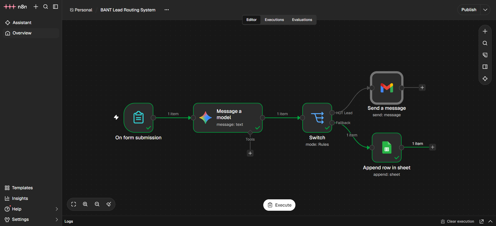

# AI-Powered BANT Lead Scoring & Routing System


An automated, AI-driven inbound lead qualification and routing pipeline built with **n8n** and **Google Gemini AI**. This system captures prospect inquiries via a web form, evaluates them against the **BANT (Budget, Authority, Timeline)** sales framework, assigns a dynamic qualification score (`0–100`), and routes **HOT** leads to sales via Gmail while logging **COLD** leads into Google Sheets for nurturing.

---

## 🎥 Live Demo Video

Watch the complete end-to-end walkthrough and live execution of this workflow on YouTube:

[](https://youtu.be/t0t2ARwddd8?si=bwXpenKS_8LdSJhx)

🔗 **Direct Video Link:** [https://youtu.be/t0t2ARwddd8?si=bwXpenKS_8LdSJhx](https://youtu.be/t0t2ARwddd8?si=bwXpenKS_8LdSJhx)

---

## 🏗️ System Architecture & Workflow



### How It Works
1. **Lead Capture (`On form submission`):** Collects structured prospect responses for **Budget**, **Authority**, and **Timeline** through an n8n Form Trigger.
2. **AI Qualification (`Message a model`):** Sends the lead data to **Google Gemini AI**, which evaluates weighted BANT signals and returns a strict JSON payload containing `score`, `status`, and a human-readable `reason`.
3. **Conditional Routing (`Switch`):** Inspects the AI-generated `status` (`HOT` when `score >= 60`, otherwise `COLD`) and splits execution into two dedicated paths.
4. **Action Execution:**
   - **HOT Lead Path (`Send a message`):** Dispatches an immediate priority email alert with full lead details and AI reasoning to the sales team via Gmail.
   - **COLD Lead Path (`Append row in sheet`):** Appends the prospect record and score into a structured Google Sheet (`COLD Lead List`) for long-term follow-up.

---

## ✨ Key Features

- **Context-Aware BANT Scoring:** Goes beyond rigid static rules—recognizes high-intent edge cases (e.g., strong decision-making authority + immediate 1-month timeline) even on tighter budgets.
- **Deterministic JSON Parsing:** Enforces clean JSON output from Gemini AI for zero-error downstream mapping in n8n expressions.
- **Dual-Channel Automated Routing:** Eliminates manual lead triage by separating high-priority buyers from early-stage prospects in real time.
- **Privacy-First & Plug-and-Play:** Includes a sanitized workflow template, CSV sheet schema, and sample test payloads ready for instant deployment.

---

## 📂 Repository Structure

```text
ai-bant-lead-scoring/
├── assets/
│   ├── workflow-architecture.png    # Complete n8n canvas overview
│   ├── lead-form-ui.png             # Inbound BANT qualification form UI
│   ├── hot-lead-email.png           # Automated Gmail alert preview
│   └── cold-lead-sheet.png          # Google Sheets fallback log preview
├── data/
│   ├── sample-leads.json            # Test cases (HOT, Edge Case, COLD) & expected AI outputs
│   └── cold-leads-template.csv      # Ready-to-import Google Sheets header template
├── docs/
│   ├── bant-scoring-logic.md        # Detailed AI scoring rules, JSON schema & thresholds
│   └── setup-guide.md               # Step-by-step n8n node configuration instructions
├── workflows/
│   └── bant-lead-scoring-workflow.json  # Sanitized n8n workflow ready for import
├── .env.example                     # Environment variables & credential reference
├── .gitignore                       # Excludes secrets, raw backups, and OS artifacts
├── LICENSE                          # MIT License
└── README.md                        # Project documentation
---

## 📬 Contact

Have questions, feedback, or want to collaborate on workflow automation projects? Feel free to reach out:

- **Author:** Ferdous Hasan Maruf
- **Email:** [ferdoushasanmaruf16@gmail.com](mailto:ferdoushasanmaruf16@gmail.com)
- **GitHub:** [@fhm16](https://github.com/fhm16)
